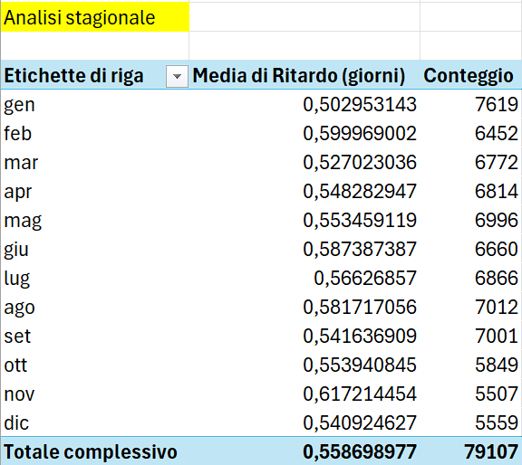

# Shipping Delay Analysis
 
**Il ritardo dipende da un trasporto lento o da una promessa irrealistica?**
 
**Strumenti:** Excel, Power Query, tabelle pivot
**Dataset:** [DataCo Smart Supply Chain (pubblico)](https://www.kaggle.com/datasets/shashwatwork/dataco-smart-supply-chain-for-big-data-analysis)

## Indice

- [Risultato in breve](#risultato-in-breve)
- [Dataset](#dataset)
- [Preparazione dei dati](#preparazione-dei-dati)
  - [Power Query](#power-query)
  - [Colonne calcolate](#colonne-calcolate)
  - [Filtro sugli stati dell'ordine](#filtro-sugli-stati-dellordine)
  - [Deduplicazione](#deduplicazione)
- [Analisi](#analisi)
  - [Geografia](#geografia)
  - [Stagionalità](#stagionalità)
  - [Categoria](#categoria)
  - [Modalità di spedizione](#modalità-di-spedizione)
- [Conclusione](#conclusione)
- [Limiti](#limiti)

---
 
## Risultato in breve
 
Il ritardo non dipende dalla geografia, dalla stagione o dal prodotto, ma dalla **modalità di spedizione**. In First Class la promessa è irrealistica; in Second Class il servizio premium non è più veloce della Standard.
 
---
 
## Dataset
 
Ho usato DataCo, un dataset pubblico di supply chain di un'azienda che vende online in tutto il mondo. Contiene circa 180.000 righe.
 
La prima cosa che ho capito è la granularità: ogni riga non corrisponde a un ordine, ma a un articolo all'interno di un ordine. Lo stesso Order Id, quindi, si ripete tante volte quanti sono i prodotti dell'ordine.
 
Ogni riga contiene due tipi di informazioni:
- **Quelle relative all'ordine:** data, modalità di spedizione, giorni di consegna previsti e reali, stato della consegna.
- **Quelle relative all'articolo:** prodotto, categoria, quantità, prezzo, sconto.
Il ritardo è un'informazione dell'ordine, quindi per analizzarlo ho tenuto una sola riga per ordine. Altrimenti un ordine con cinque articoli avrebbe pesato cinque volte.
 
---
 
## Preparazione dei dati
 
### Power Query
 
Il primo passo è stato aprire i dati in Power Query. Poiché i separatori decimali non venivano letti correttamente, ho importato il file con le impostazioni internazionali inglese (Stati Uniti) e ho assegnato a ogni colonna il tipo di dato corretto. Sempre in Power Query ho eliminato le colonne non necessarie. Ho poi verificato la presenza di duplicati ed errori con le funzioni "Mantieni duplicati" e "Mantieni errori". Non sono emersi errori. Con "Mantieni duplicati", invece, sono comparse molte righe, com'è normale, perché ogni ordine comprende più articoli.
 
### Colonne calcolate
 
Per prima cosa ho calcolato due nuove colonne:
- **Ritardo**, come differenza tra i giorni di spedizione reali e quelli previsti (un valore negativo indica una consegna in anticipo);
- **In ritardo**, una colonna binaria creata con la funzione `SE()`.
Ho creato queste colonne direttamente in Excel e non in Power Query, perché ho più dimestichezza con le formule di Excel che con il linguaggio M. Il metodo più pulito, però, sarebbe stato farlo direttamente in Power Query, in linguaggio M.
 
### Filtro sugli stati dell'ordine
 
Ho tenuto solo gli ordini con stato `COMPLETE` e `CLOSED`, cioè quelli sicuramente consegnati. Gli altri stati, come `PENDING` o `PROCESSING`, rappresentano ordini non ancora conclusi, eppure nel dataset hanno comunque i giorni di consegna compilati, il che non è coerente. Ho escluso anche gli ordini `CANCELED` e `SUSPECTED_FRAUD`, che non sono né puntuali né in ritardo. Ho preferito lavorare su dati affidabili. Sono rimaste 79.107 righe su circa 180.000, più che sufficienti per l'analisi.
 
### Deduplicazione
 
Ho duplicato la query in Power Query e nella copia ho rimosso i duplicati su `Order Id`, in modo da avere una sola riga per ordine: **28.965 ordini**. Ogni riga del dataset originale è un articolo, e senza questo passaggio gli ordini con più articoli avrebbero pesato di più nel calcolo del ritardo.
 
Ho usato la tabella deduplicata per le analisi sugli attributi dell'ordine (geografia e modalità di spedizione). Per la categoria ho usato la tabella a livello di articolo, perché la categoria è un attributo del prodotto e non dell'ordine.
 
---
 
## Analisi
 
Ho testato un'ipotesi alla volta, escludendo quelle che non spiegano il ritardo.
 
### Geografia
 
Ho creato una tabella pivot con **Market** e **Order Country** nelle righe, e con la **media del ritardo (in giorni)**, la **deviazione standard** e il **conteggio** nei valori. Ho poi ordinato i valori dal più grande al più piccolo, sia i market tra loro sia i paesi all'interno di ogni market, per vedere subito dove si concentrano i ritardi.
 
I market hanno ritardi medi molto simili, tra **0,52 giorni (LATAM)** e **0,61 giorni (USCA)**, e una deviazione standard quasi identica (circa 1,5 giorni). Non si può concludere che esista una dipendenza geografica dei ritardi di spedizione. Le differenze tra singoli paesi riguardano paesi con pochi ordini (circa 100-200), su cui la media è poco affidabile.
 

  

### Stagionalità
 
Anche al variare dei mesi il ritardo non cambia in modo significativo: la media va da **0,50 giorni (gennaio)** a **0,62 giorni (novembre)**.
 

  

### Categoria
 
Anche al variare della categoria il ritardo non cambia in modo significativo. Le categorie con più articoli (Fan Shop, Apparel, Golf) hanno tutte un ritardo medio tra **0,55 e 0,57 giorni**. I valori più alti, come Book Shop (0,69), riguardano categorie con pochi articoli.
 

  

### Modalità di spedizione
 
Per quanto riguarda la modalità di spedizione, invece, c'è una differenza significativa.

 

  

---
 
## Conclusione
 
Il ritardo non dipende dalla geografia, dalla stagione o dal prodotto, ma dalla modalità di spedizione, per due motivi diversi.
 
- **First Class:** il trasporto è veloce e costante (sempre 2 giorni, deviazione standard 0), ma si promette 1 giorno, che non si riesce a garantire: basterebbe allineare la promessa a 2 giorni.
- **Second Class:** il problema è più serio: i tempi reali (circa 4 giorni) sono identici a quelli della Standard, quindi il servizio premium non è più veloce. Lì indagherei il processo, per capire se gli ordini Second Class vengono prioritizzati in magazzino o se finiscono nello stesso flusso della Standard.
- **Same Day:** circa metà degli ordini arriva il giorno dopo invece che in giornata.
- **Standard Class:** è la modalità in cui promessa e realtà sono più allineate in media (4 giorni promessi, 3,99 reali), anche se con una variabilità di circa ±1,4 giorni.
---
 
## Limiti
 
- Valori così esatti, come la deviazione standard pari a 0 in First Class, fanno pensare che il dataset sia in parte simulato. In un'azienda reale verificherei i dati con chi gestisce le spedizioni prima di trarre conclusioni.
- Il dataset non contiene dati di magazzino o di stock, quindi non è possibile capire in quale fase della catena nasce il ritardo.
 
