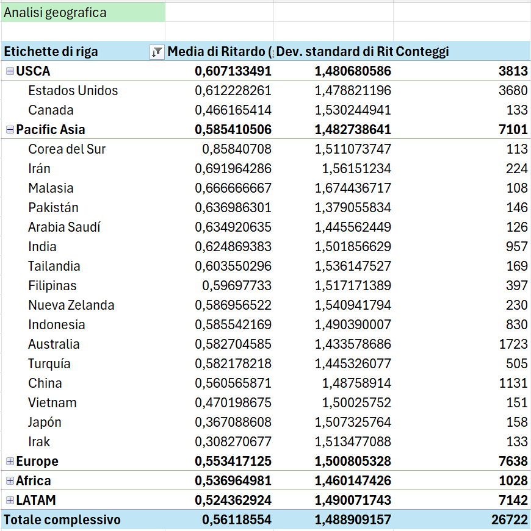
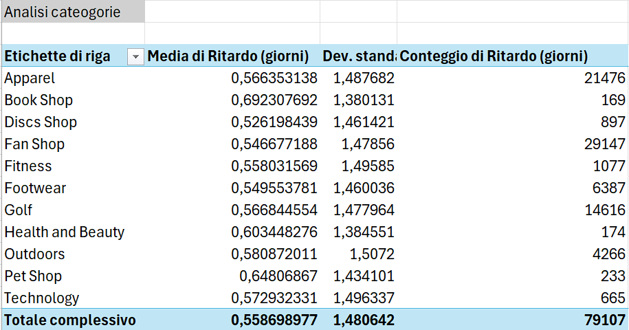
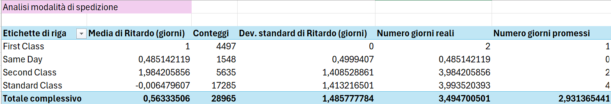

# Shipping Delay Analysis
 
**Il ritardo dipende da un trasporto lento o da una promessa irrealistica?**
 
---
 
## Dataset
 
Ho usato DataCo, un dataset pubblico di supply chain di un'azienda che vende online in tutto il mondo. Contiene circa 180.000 righe.
 
La prima cosa che ho capito è la granularità: ogni riga non corrisponde a un ordine, ma a un articolo all'interno di un ordine. Lo stesso Order Id, quindi, si ripete tante volte quanti sono i prodotti dell'ordine.
 
Ogni riga contiene due tipi di informazioni:
- **Quelle relative all'ordine:** data, modalità di spedizione, giorni di consegna previsti e reali, stato della consegna.
- **Quelle relative all'articolo:** prodotto, categoria, quantità, prezzo, sconto.
Il ritardo è un'informazione dell'ordine, quindi per analizzarlo ho tenuto una sola riga per ordine. Altrimenti un ordine con cinque articoli avrebbe pesato cinque volte.
 
Ho escluso anche le spedizioni annullate, che non sono né puntuali né in ritardo.
 
---
 
## Preparazione dei dati
 
### Power Query
 
Il primo passo è stato aprire i dati in Power Query. Poiché i separatori decimali non venivano letti correttamente, ho importato il file con le impostazioni internazionali inglese (Stati Uniti) e ho assegnato a ogni colonna il tipo di dato corretto. Sempre in Power Query ho eliminato le colonne non necessarie. Ho poi verificato la presenza di duplicati ed errori con le funzioni "Mantieni duplicati" e "Mantieni errori". Non sono emersi errori. Con "Mantieni duplicati", invece, sono comparse molte righe, com'è normale, perché ogni ordine comprende più articoli.
 
Dopo queste verifiche ho caricato la tabella in Excel. La domanda a cui volevo rispondere è: **il ritardo dipende da un trasporto lento o da una promessa irrealistica?**
 
### Colonne calcolate
 
Per prima cosa ho calcolato due nuove colonne:
- **Ritardo**, come differenza tra i giorni di spedizione reali e quelli previsti;
- **In ritardo**, una colonna binaria creata con la funzione `SE()`.
Ho creato queste colonne direttamente in Excel e non in Power Query, perché ho più dimestichezza con le formule di Excel che con il linguaggio M. Il metodo più pulito, però, sarebbe stato farlo direttamente in Power Query, in linguaggio M.
 
### Filtro sugli stati dell'ordine
 
Ho tenuto solo gli ordini con stato `COMPLETE` e `CLOSED`, cioè quelli sicuramente consegnati. Gli altri stati, come `PENDING` o `PROCESSING`, rappresentano ordini non ancora conclusi, eppure nel dataset hanno comunque i giorni di consegna compilati, il che non è coerente. Ho preferito lavorare su dati affidabili. Sono rimaste circa 80.000 righe su 180.000, più che sufficienti per l'analisi.
 
### Deduplicazione
 
Ho duplicato la query in Power Query e nella copia ho rimosso i duplicati su `Order Id`, in modo da avere una sola riga per ordine. Ogni riga del dataset originale è un articolo, e senza questo passaggio gli ordini con più articoli avrebbero pesato di più nel calcolo del ritardo. Ho poi collegato la tabella pivot alla nuova tabella deduplicata, chiamata `No_Duplicati`.
 
---
 
## Analisi
 
### Geografia
 
Ho creato una tabella pivot con **Market** e **Order Country** nelle righe, e con la **media del ritardo (in giorni)** e il **conteggio delle righe** nei valori. Ho poi ordinato i valori dal più grande al più piccolo, sia i market tra loro sia i paesi all'interno di ogni market, per vedere subito dove si concentrano i ritardi.
 
Ho aggiunto anche la deviazione standard. Dall'immagine si vede chiaramente che non si può concludere che esista una dipendenza geografica dei ritardi di spedizione.

  

 
### Stagionalità
 
Passiamo all'analisi per stagionalità. Anche qui, al variare dei mesi, il ritardo non cambia in modo significativo.

  

 
### Categoria
 
Passiamo all'analisi per categoria. Anche qui, al variare della categoria, il ritardo non cambia in modo significativo.

  

### Modalità di spedizione
 
Per quanto riguarda la modalità di spedizione, invece, c'è una differenza significativa.

  

 
Il problema, quindi, sta nel tipo di spedizione. A questo punto mi chiederei perché succede: forse è un problema logistico, e cercherei di risolverlo.
 
---
 
## Conclusione
 
Il ritardo non dipende dalla geografia, dalla stagione o dal prodotto, ma dalla modalità di spedizione, per due motivi diversi.
 
- **First Class:** il trasporto è veloce e costante, ma si promette un giorno che non si riesce a garantire: basterebbe allineare la promessa a 2 giorni.
- **Second Class:** il problema è più serio: i tempi reali sono identici a quelli della Standard, quindi il servizio premium non è più veloce. Lì indagherei il processo, per capire se gli ordini Second Class vengono prioritizzati in magazzino o se finiscono nello stesso flusso della Standard.
- **Standard Class:** è la modalità più affidabile e quella in cui promessa e realtà sono più allineate.
 
